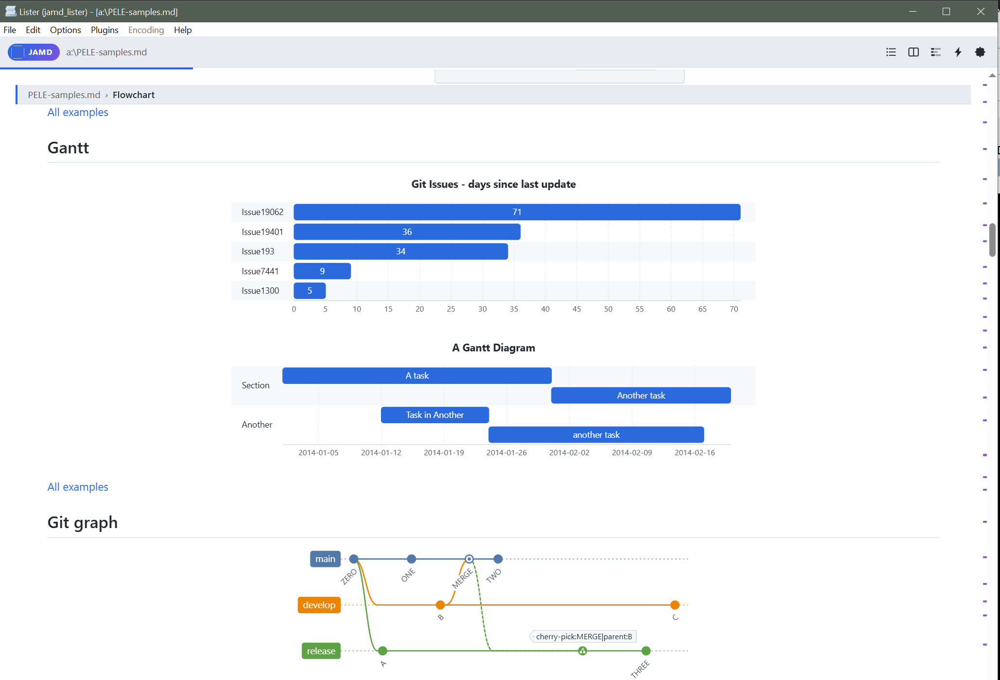

# Just Another MD Lister (JAMD)

A **Total Commander Lister (WLX) plugin** that renders Markdown files with a clean, GitHub-styled preview. Powered by Microsoft **WebView2**, read-only, 64-bit and 32-bit.

  

---
### News — v1.6: Pele diagrams



Mermaid diagrams can now be drawn by **[Pele](https://pele.run)**, a new renderer
that is about **5× faster** than Mermaid and one-eighth of its size.

- **Settings ▸ Diagrams**: Mermaid or Pele (`Diagrams=mermaid|pele`). 58 sample
  diagrams render in 275 ms instead of 1,600 ms; light/dark switches recolour
  them instantly.
- 30+ diagram types: flowchart, Gantt, sequence, Git graph, mind map, timeline,
  C4, Kanban, Sankey, treemap, …

**Now also for 32-bit Total Commander**: `JAMD_lister.wlx` ships beside
`JAMD_lister.wlx64`, with the same features.

**Also new in 1.6**
- **`[[Wiki links]]`** open the linked note; **backlinks** list the notes that link here
- **Front matter** shown as a properties card instead of a stray rule and heading
- **Section path** above the document (`file › Chapter › Section`), clickable
- **Scrollbar marks** for headings, find hits and warnings
- **Document checks**: heading jumps, duplicate headings, dead anchors, missing alt text
- `Ctrl+Shift+M` **focus mode**, `Ctrl+Shift+C` **copy as rich text** (paste into Outlook / Word)
- Optional features are one 0/1 key each in `JAMD.ini` (see `JAMD.ini.sample`)

**Faster** (6,000-block document)
- About **4× faster scrolling**: the contents pane no longer re-lays the whole
  preview on every scroll frame.
- First paint is about 35 % quicker.
- Prism loads only when a document needs it.

**Libraries**: Mermaid 12.2, KaTeX 0.19, markdown-it 15.0.3, DOMPurify 3.4.17.

The lister shares its source and `lib\` with the
[JAMD Editor](https://github.com/mikinko/JustAnotherMD_Editor). Installed in
the same folder, both use one `JAMD.ini`, and a library update made in the
editor reaches the lister too.

*Earlier — v1.3:* JAMD grew from a Markdown viewer into a multi-format
previewer for HTML, JSON, YAML, TOML and Jupyter notebooks.

## Features

### Rendering
- **GitHub-style Markdown** (markdown-it + DOMPurify sanitizer) — read-only, safe
- **Syntax highlighting** for code blocks — Prism.js, ~297 languages
- **Mermaid diagrams** (flowcharts, sequence, gantt, …) — lazy-loaded, drawn by Mermaid or the faster **Pele**
- **KaTeX math**, definition lists, sub/superscript, abbreviations, `{#id .class}` attributes
- **GFM extras**: tables, task lists, strikethrough, `==highlight==`, footnotes
- **Alert blockquotes**: `[!NOTE]`, `[!TIP]`, `[!IMPORTANT]`, `[!WARNING]`, `[!CAUTION]`
- **Heading anchors** with permalink links
- **Local links**: same-page anchors, cross-document `other.md#section` navigation
- **Relative images/assets** resolved against the document folder
- **Line highlighting** via fence info string, e.g. ```` ```js {2,5-7} ````
- **Print stylesheet** (Ctrl+P) — clean, chrome-free output

### Interface
- **Themes**: System / Light / Dark (built-in) + editable JSON color presets in `themes/`
- **Code-highlight themes**: GitHub Light/Dark, Prism, Okaidia, Tomorrow, Solarized Light
- **Collapsible Table of Contents** built from document headings
- **Split view**: rendered preview alongside raw source, with scroll sync
- **Bionic reading mode** (fixation bolding)
- **Adjustable zoom** (50–200 %) and **reading width** (600–2000 px)
- **Line numbers** toggle for code blocks
- **Code block tools**: copy button + word-wrap toggle
- **Scroll-progress bar** and **status footer**: word count, ~reading time, heading/line counts, live scroll %
- **Back-to-top** button
- **WebView2 cache location** control (system profile or custom folder)
- Settings **persisted to INI** (no localStorage, no telemetry)

### Keyboard shortcuts

| Shortcut | Action |
|----------|--------|
| `Ctrl` `+` / `-` / `0` | Zoom in / out / reset |
| `Ctrl` `D` | Toggle dark / light |
| `Ctrl` `T` | Table of contents |
| `Ctrl` `S` | Toggle split view |
| `Ctrl` `Q` | Sync split panes to current position |
| `Ctrl` `L` | Toggle line numbers |
| `Ctrl` `B` | Bionic reading mode |
| `Ctrl` `G` | Go to top |
| `Ctrl` `F` | Find in page |
| `F3` / `Shift` `F3` | Find next / previous |
| `Ctrl` `A` | Select all |
| `Ctrl` `P` | Print |
| `Esc` | Close viewer |
| `F1` | This shortcut list |

---

## Requirements

- **Windows 10 / 11** + **Total Commander** 64-bit (`JAMD_lister.wlx64`) or 32-bit (`JAMD_lister.wlx`).
- The plugin's C/C++ runtime is **statically linked** — no Visual C++ Redistributable needed.
- **Microsoft Edge WebView2 Runtime** — required. This is the only external dependency.

> Windows 11 normally ships the WebView2 Runtime. Minimal/clean images (e.g. **Windows Sandbox**, stripped Server, some LTSC builds) do **not** include it, so the plugin will show *"WebView2 Runtime is not available."* You need to provide the runtime via one of the two options below.
>
> ⚠️ A single DLL is **not** enough — WebView2 is a full Edge/Chromium runtime (an `msedgewebview2.exe` plus many support files). You cannot fix this by copying one file into the plugin folder.

### Option A — Install the Evergreen Runtime (recommended)

One-time, machine-wide; auto-updates with Edge.

1. Download the **Evergreen Standalone Installer** from Microsoft:
   <https://developer.microsoft.com/microsoft-edge/webview2/>
   (file: `MicrosoftEdgeWebView2RuntimeInstallerX64.exe`)
2. Run it. Done — reopen the plugin.

### Option B — Fixed Version runtime (portable, no install)

Ship the runtime alongside the plugin and point the plugin at it via an environment variable. Nothing is installed system-wide.

1. Download the **Fixed Version** runtime (x64) from the WebView2 page above.
2. Extract the archive to a folder, e.g.:
   ```
   C:\Tools\WebView2Runtime\Microsoft.WebView2.FixedVersionRuntime.<version>.x64\
   ```
3. Set a **system environment variable** pointing at that folder:
   ```
   WEBVIEW2_BROWSER_EXECUTABLE_FOLDER = C:\Tools\WebView2Runtime\Microsoft.WebView2.FixedVersionRuntime.<version>.x64
   ```
   (The folder must contain `msedgewebview2.exe`.)
4. Restart Total Commander so it inherits the variable.

The plugin reads this variable automatically — no configuration change required.

---

## Installation

1. Download the latest release archive from the [Releases](../../releases) page.
2. Extract it into your Total Commander plugins folder, keeping the structure intact:

   ```
   …\Totalcmd\plugins\wlx\JAMD_lister\
   ├─ JAMD_lister.wlx64       ← the plugin, 64-bit Total Commander
   ├─ JAMD_lister.wlx         ← the plugin, 32-bit Total Commander
   ├─ pluginst.inf            ← lets TC install it on open
   ├─ lib\                    ← markdown-it, DOMPurify, Prism, Mermaid, Pele, KaTeX
   ├─ themes\                 ← color presets (editable JSON)
   └─ JAMD.ini                ← created automatically on first run
   ```

3. In Total Commander: **Configuration → Options → Plugins → Lister (WLX) → Configure → Add**, and select `JAMD_lister.wlx64` (64-bit TC) or `JAMD_lister.wlx` (32-bit TC).
   *(Or open the release ZIP in TC and confirm the install prompt; it picks the right one.)*
4. Open any `.md` / `.markdown` file in Lister (`F3`). The plugin handles it automatically.

**Supported extensions:** `.md`, `.markdown`, `.mdown`, `.mkd`, `.mkdn`

---

## Configuration

Settings are stored in `JAMD.ini` under the `[JAMD]` section, shared with the editor. The everyday ones are also in the ⚙ settings panel; `JAMD.ini.sample` documents every key.

| Key | Meaning | Values |
|-----|---------|--------|
| `Theme` | Color theme | `system` (default), `github-light`, `github-dark`, or a preset name from `themes/` |
| `CodeTheme` | Code highlight style | `auto` (default), `github-light`, `github-dark`, `prism`, `okaidia`, `tomorrow`, `solarized-light` |
| `Diagrams` | Diagram renderer | `mermaid` (default), `pele` |
| `WikiLinks`, `Backlinks`, `FrontMatter`, `Breadcrumb`, `ScrollMarks`, `DocLint` | Optional features | `1` (default) / `0` |
| `TOC` | Table of contents shown | `0` / `1` |
| `Split` | Split source view shown | `0` / `1` |
| `Bionic` | Bionic reading mode | `0` / `1` |
| `Zoom` | Zoom level | `50`–`200` (%) |
| `Width` | Reading width | `600`–`2000` (px) |
| `CacheMode` | WebView2 profile location | `system` / `custom` |
| `CachePath` | Custom cache folder | absolute path (when `CacheMode=custom`) |

### Custom themes

Drop a JSON file into `themes/` to add a color preset; it appears in the theme dropdown automatically. See the existing files for the format.

---

## Credits

- [markdown-it](https://github.com/markdown-it/markdown-it) + [markdown-it-footnote](https://github.com/markdown-it/markdown-it-footnote) — Markdown engine
- [DOMPurify](https://github.com/cure53/DOMPurify) — HTML sanitizer
- [Prism.js](https://prismjs.com/) — syntax highlighting
- [Mermaid](https://mermaid.js.org/) and [Pele](https://pele.run) — diagrams
- [KaTeX](https://katex.org/) — math
- Microsoft [WebView2](https://developer.microsoft.com/microsoft-edge/webview2/) — rendering host
- Total Commander [WLX SDK](https://www.ghisler.com/plugins.htm)
